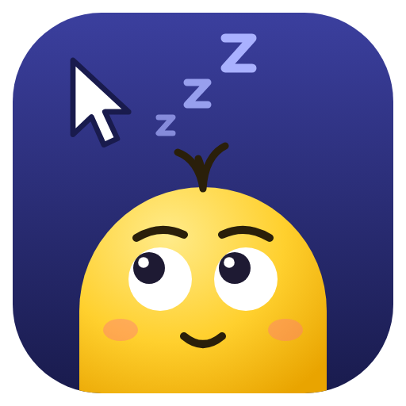
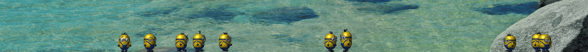

<p align="center">
  
</p>

<h1 align="center">IdleWalker</h1>

<p align="center">
  <b>Stop moving your mouse, and the little guys come out to play.</b><br>
  A tiny desktop companion that wanders along the bottom of your screen while you're away.<br>
  It runs on Windows, macOS and Linux. Written in Rust.
</p>

<p align="center">
  <a href="https://github.com/i-oms/IdleWalker/releases/latest"></a>
  <a href="https://github.com/i-oms/IdleWalker/releases"></a>
  <a href="https://github.com/i-oms/IdleWalker/stargazers"></a>
  <br>
  <a href="https://github.com/i-oms/IdleWalker/actions/workflows/build.yml"></a>
  
  
  <a href="LICENSE"></a>
</p>

<p align="center">
  <a href="#-download">Download</a> •
  <a href="#-what-it-does">Features</a> •
  <a href="#-meet-the-cast">The cast</a> •
  <a href="#-faq">FAQ</a> •
  <a href="docs/DEVELOPMENT.md">Developers</a>
</p>

<p align="center">
  
</p>

---

## ✨ What is this?

Leave your mouse alone for **two seconds**. A small, shaded, 3D-looking character peeks over the
bottom edge of your screen, hops out, and starts strolling along your monitors.

Then it gets on with its day. It waves, dances, dozes off standing up and pranks the timid
ones. **Move the mouse** and it gets a fright and dives back out of sight.

It isn't a screensaver, and it doesn't get in your way. Clicks pass straight through it, it stays
out of full-screen apps, and it lives quietly in your tray.

## 🚀 Download

Grab the zip for your OS from the **[latest release](https://github.com/i-oms/IdleWalker/releases/latest)**.
It holds the app together with the README and licenses, and needs no installer.

| OS | File | Run it |
| --- | --- | --- |
| 🪟 **Windows 10/11** | `idlewalker-<version>-windows-x64.zip` | Unzip it, then double-click `idlewalker.exe`. |
| 🍎 **macOS** (Apple Silicon & Intel) | `idlewalker-<version>-macos.zip` | Unzip it, then drag **IdleWalker** to Applications and open it from there. |
| 🐧 **Linux** (x64) | `idlewalker-<version>-linux-x64.zip` | Unzip it, then run `chmod +x idlewalker-*/idlewalker && ./idlewalker-*/idlewalker`. |

> [!NOTE]
> The builds aren't code-signed yet, so the first launch needs one extra click.
> - **Windows:** on the SmartScreen prompt, choose **More info**, then **Run anyway**.
> - **macOS:** open it once, then choose **Open Anyway** under **System Settings › Privacy & Security**.
> - **Linux:** if your unzip tool drops the executable bit, the `chmod` above puts it back.

Once it's running, look for it in the tray (or the menu bar on macOS). **Right-click** opens
settings and **left-click** opens the brightness panel.

<details>
<summary><b>Or build it yourself</b></summary>

```sh
git clone https://github.com/i-oms/IdleWalker.git
cd IdleWalker
cargo build --release
./target/release/idlewalker     # idlewalker.exe on Windows
```

</details>

## 🎭 What it does

- 🧍 **A cast of 20 walkers.** Each one has a temperament: calm, friendly, aggressive, timid,
  goofy or feisty.
- 🤹 **43 antics.** They dance, moonwalk, twirl, salute, doze, sleepwalk, play peekaboo, do
  push-ups, launch themselves and blow up in a rage.
- 🧠 **They learn.** Every walker remembers what went well and what didn't, and slowly develops
  its own tastes. The **Brains** dashboard shows what each one has picked up.
- 🤝 **They get on with each other (or don't).** The friendly ones stop to say hello, bullies
  shove, timid ones hide and faint, and the clowns copy whatever they see.
- 🖱️ **They notice you.** They wave at the cursor, point and giggle at it, and bolt the moment
  you come back.
- 🖥️ **Multi-monitor.** They stroll across every screen you have.
- 👻 **Out of your way.** Clicks pass through them, they always stay on top, they keep clear of
  full-screen apps, and on Windows they're hidden from screenshots and screen shares.

### Plus a few handy extras

- ↘️ **Hot corners.** Push the cursor into a screen corner to open Task View, show the desktop,
  lock the screen, turn the monitor off, and more.
- 🔆 **Brightness panel.** Adjust every monitor from the tray, including **external monitors over
  DDC/CI**, and use the mouse wheel to fine-tune.
- 🟡 **Click highlight.** Turn on *Highlight mouse clicks* and every click shows a spot under the
  cursor, yellow for the left button and blue for the right, on whichever monitor you click.
  Unlike the walkers it shows in recordings and screen shares, which is what it is for.
  Both colours are yours to pick in the menu.
- 🔦 **Find cursor.** Tick *Find cursor* and press Ctrl twice: a dark halo closes in on the
  cursor, wherever it is on your monitors. A click, a key or a few seconds' rest sends it away.
  The key is yours to pick in the menu: Ctrl, Shift or Alt (Option on a Mac). So is the
  colour of the ring.
- 💻 **Terminal prompt.** A window that sets up [Oh My Posh](https://ohmyposh.dev) for you:
  installs or updates it, fetches its themes, puts the one you pick into every shell you have
  (PowerShell, Windows PowerShell, bash, zsh, fish, Command Prompt through Clink, nu), installs
  the Nerd Font its icons need, and points your terminals at that font, every profile of
  each: VS Code and its cousins, Zed, Windows Terminal, console windows, ConEmu and Cmder,
  PuTTY, Git Bash, MSYS2, Cygwin and wsltty, macOS Terminal and iTerm2, GNOME Terminal and
  Console, Ptyxis, Tilix, MATE Terminal, Konsole, Xfce Terminal, Terminator, Guake,
  elementary Terminal, LXTerminal, QTerminal, Deepin Terminal, Sakura, foot, xterm and
  urxvt, and the cross-platform kitty, Alacritty, Tabby, Hyper, Rio, Warp and Wave. It also
  turns off the colour rules in VS Code and Windows Terminal that recolour the prompt.
  Everything it changes is written down first, so one click puts the terminals back as they
  were, another takes the prompt out of every shell, and "Uninstall" does both and removes
  Oh My Posh and the font it installed.
- ☕ **Anti-idle nudge.** Keeps your machine awake when you want it to.
- 🔄 **Update check.** It tells you when there's a new release, but never installs anything on
  its own.
- 🪶 **Lightweight.** A single native Rust binary with a software renderer, and no Electron or
  web view.

## 👋 Meet the cast

The walkers came from a C# Windows app that grew into a full cast with personalities, moods and
memories. Its [original README](https://github.com/i-oms/fun-desktop#readme) describes how they
get on with each other and every tuning knob. This cross-platform Rust version keeps the Minions
and the Angry Birds, and an existing cast keeps its memories.

## ❓ FAQ

<details>
<summary><b>Will it slow my computer down?</b></summary>

It only draws while you're idle, it backs off to half the frame rate on battery, and it stays out
of the way of full-screen apps and games.
</details>

<details>
<summary><b>Will it show up in my screen share or screenshots?</b></summary>

On Windows, no. On macOS, only where macOS still honours the request to hide it. On Linux, yes.
</details>

<details>
<summary><b>How do I make it start when I sign in?</b></summary>

Turn on **Start at sign-in** in the settings menu (right-click the tray icon).
</details>

<details>
<summary><b>Does it work on Wayland?</b></summary>

Yes, through XWayland, with some limits: Wayland hides the cursor from apps while it's over
native Wayland windows, so idle detection and hot corners are less reliable there. See the
[platform matrix](docs/DEVELOPMENT.md#platform-differences) for details.
</details>

<details>
<summary><b>What does it need to run?</b></summary>

| OS | Needs |
| --- | --- |
| Windows | Windows 10 1703 or later. Nothing to install. |
| macOS | Nothing to install. Run it from Applications, not from the unzipped folder, or *Start at login* will point at a path that may go away. Hot corners that send keys ask for the Accessibility permission. |
| Linux | glibc 2.28+ (Debian 10 / Ubuntu 20.04 and newer), X11 or XWayland with a compositing window manager. For the tray icon, StatusNotifierItem support (KDE, or GNOME with the AppIndicator extension). Optional: `ddcutil` for external monitor brightness and `brightnessctl` for the built-in panel. |
</details>

<details>
<summary><b>Where are my settings stored?</b></summary>

`%APPDATA%\IdleWalker` on Windows, `~/Library/Application Support/IdleWalker` on macOS, and
`~/.config/idlewalker` on Linux. That folder holds `settings.txt` (your menu choices) and
`brains.txt` (what the walkers have learned). Delete `brains.txt` to give the cast a fresh start,
or use **Brains › Forget everything...**.
</details>

## 🛠️ For developers

The architecture, the C#-to-Rust translator, the port checker, the platform differences and the
release process are all in **[docs/DEVELOPMENT.md](docs/DEVELOPMENT.md)**.

## 🤝 Contributing

New antics, platform fixes, packaging (winget, Homebrew, AUR, Flatpak) and bug reports are all
very welcome. Start with [CONTRIBUTING.md](CONTRIBUTING.md), and please follow the
[Code of Conduct](CODE_OF_CONDUCT.md). To report a security issue, see [SECURITY.md](SECURITY.md).

**If IdleWalker made you smile, please ⭐ star the repo.** It really helps other people find it.

## 📜 License

The code is under the [MIT License](LICENSE). The bundled font and the Rust crates have their own
licenses, listed in [THIRD_PARTY_NOTICES.md](THIRD_PARTY_NOTICES.md).

IdleWalker is an unofficial fan project, and isn't affiliated with or endorsed by the owners of
the characters it draws. The characters and their names belong to their owners, and the MIT
License grants no rights in them.
